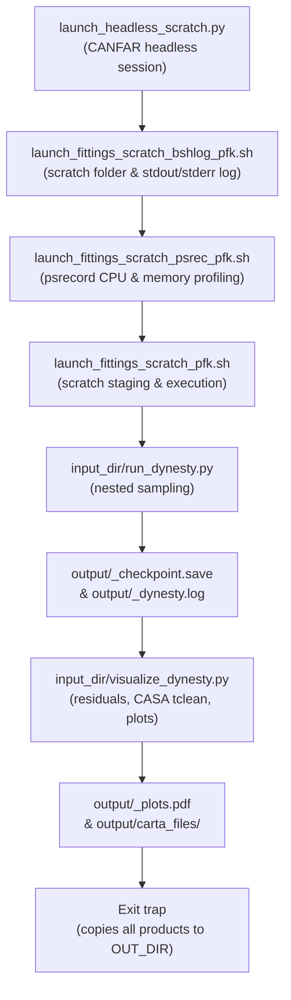

# ALMA Visibility Modelling

> **Bayesian modelling of ALMA interferometric visibilities with Dynesty dynamic nested sampling and Galario.**
>
> *Maintained by Peter Knowlton (University of Victoria)*  
> *Forked and evolved from Emily Carver's ALMA Visibility Modelling repository.*

---

## Quick Start

1. Write a prior card for the run: copy a legacy card and edit the ranges.
   ```bash
   cp dyn_version/prior_cards/twod_gaussring_legacy.pc dyn_version/prior_cards/ngc3351-gaussring-01.pc
   ```
2. Launch the run on CANFAR:
   ```bash
   cd dyn_version
   python launch_headless_scratch.py ngc3351-gaussring-01 twod_gaussring M95_C5+C2_cont93_uvtable_freq.txt
   ```
3. Results appear in `/arc/projects/uvdisk_fit/results/dyn_results/ngc3351-gaussring-01/`.

Details are in [How to Run](#how-to-run).

---

## Scientific Overview

### Why Model in the Visibility (Fourier) Domain?

Interferometers like **ALMA** do not record sky images directly. Each antenna pair samples a spatial Fourier frequency $(u, v)$ of the sky brightness, giving **complex visibilities**:

$$V(u, v) = \iint I(x, y) \, e^{-2\pi i (ux + vy)} \, dx \, dy$$

Images are normally reconstructed by Fourier inversion and deconvolution (`CLEAN`), but incomplete $(u, v)$ coverage, the non-linear deconvolution and correlated image noise can bias parameters measured from the image.

**Visibility modelling** skips the image:
1. Propose a parametric 2D brightness model $I(x, y; \theta)$.
2. Compute its visibilities $V_{\text{mod}}(u, v; \theta)$ with **[Galario](https://github.com/mtazzari/galario)**.
3. Compare them directly with the calibrated visibility table $(u, v, \text{Re}, \text{Im}, w)$:

$$\chi^2(\theta) = \sum_k w_k \left| V_{\text{obs}}(u_k, v_k) - V_{\text{mod}}(u_k, v_k; \theta) \right|^2$$

$$\ln \mathcal{L}(\theta) = -\frac{1}{2} \chi^2(\theta)$$

### Why Dynamic Nested Sampling (`dynesty`)?

Earlier versions of this pipeline used MCMC (`emcee`). This version uses dynamic nested sampling with **[dynesty](https://dynesty.readthedocs.io/)**, which:
- **Computes the Bayesian evidence** $\mathcal{Z} = \int \mathcal{L}(\theta)\pi(\theta)d\theta$, so models can be compared (e.g. whether a 19-parameter 3-blob model is justified over a 7-parameter smooth ring).
- **Handles multi-modal posteriors** better than a single MCMC ensemble, since it explores the whole prior volume rather than starting from one region.
- **Adds live points where the posterior mass is**, to refine the posterior estimates.

---

## Repository History

- **Emily Carver's original repository**: the initial MCMC-based ALMA visibility modelling.
- **MCMC / earlier versions**: the `emcee` MCMC and ADVI implementations are no longer in this branch; they remain in git history on the `msc-v1-archive` and `msc-v2` branches.
- **`dyn_version/`** (current): `dynesty` nested sampling with a multiprocessing pool, node-local scratch staging, resource profiling and CASA residual imaging.

---

## Pipeline Architecture (`dyn_version`)

`dyn_version/` runs fits as batch jobs on **CANFAR** (Canadian Advanced Network for Astronomical Research).

### Workflow



### Files

```
dyn_version/
├── launch_headless_scratch.py              # Launches a CANFAR headless session
├── launch_fittings_scratch_bshlog_pfk.sh   # Logging wrapper: captures stdout/stderr to bashlog.txt
├── launch_fittings_scratch_psrec_pfk.sh    # Profiling wrapper: CPU/RAM usage with psrecord
├── launch_fittings_scratch_pfk.sh          # Core runner: scratch staging, Conda environment, cleanup
├── prior_cards/                            # One prior card per run (<session_name>.pc); <model_name>_legacy.pc are starting points
└── input_dir/                              # Code run on the compute node
    ├── run_dynesty.py                      # Dynesty sampling driver (multiprocessing Pool)
    ├── model_defs.py                       # Model registry: every fittype's ring, blobs, geometry and labels
    ├── model_prof.py                       # 2D brightness models and the Galario interface
    ├── prior_tform.py                      # Prior card reader and prior transforms
    ├── radec_calc.py                       # Sky coordinates of fitted components, model WCS
    └── visualize_dynesty.py                # Post-fit residual imaging (CASA tclean) and PDF figures
```

## Software Environments

Two Python environments are needed, because CANFAR's `canfar` package needs Python $\ge 3.9$ while the `galario` and CASA builds used here need Python $\le 3.8$:

### 1. Launcher Environment (Python $\ge 3.9$)
Used by `launch_headless_scratch.py`:
- `canfar`

### 2. Execution Environment (`pk_env_38`, Python $\le 3.8$)
Used on the compute node:
- **`dynesty`** ($\ge 2.0$)
- **`galario`**
- **`casatools` & `casatasks`** (`tclean`, `impbcor`, `table`)
- **`astropy`**, **`matplotlib`**, **`corner`**, **`uvplot`**, **`pandas`**
- **`psrecord`** & **`psutil`**
- **`scipy`** & **`numpy`**

---

## How to Run

### Prior Cards

Each run reads its priors from `dyn_version/prior_cards/<session_name>.pc`. The first line names the model, followed by one `[low, high]` row per parameter, in parameter order:

```
model: twod_gaussring
[6.417, 9.417], # 0: Ring Peak brightness [log10(Jy/sr)]
[0.05, 4.0],    # 1: Ring Gaussian width sigma [arcsec]
...
```

Everything after `#` is a comment. Copy a `<model_name>_legacy.pc` card to start. To check a card before launching, run this from `input_dir/`:

```bash
python prior_tform.py ../prior_cards/<session_name>.pc
```

### Launching on CANFAR

```bash
# python launch_headless_scratch.py <session_name> <fittype> <data_file>
python launch_headless_scratch.py ngc3351-gaussring-01 twod_gaussring M95_C5+C2_cont93_uvtable_freq.txt
python launch_headless_scratch.py ngc3351-resid-01 resid_gauss3blob M95_C5+C2_cont93_uvtable_freq_residiii.txt
```

- `<data_file>` is a file name inside the data folder set at the top of `launch_headless_scratch.py` (or a full path).
- The launcher stops if the prior card is missing or names a different model.
- The CASA folder used for the residual images is chosen from the data file name (everything after `uvtable_`):

| Data table | CASA folder (inside `input_dir/`) |
|---|---|
| `M95_C5+C2_cont93_uvtable_freq.txt` | `casa_dir_freq` |
| `M95_C5+C2_cont93_uvtable_freq_residiii.txt` | `casa_dir_freq_residiii` |

The session runs on 16 CPU cores (`cores` in the launcher and `NCORES` in `run_dynesty.py`; keep them equal) and writes results to `/arc/projects/uvdisk_fit/results/dyn_results/<session_name>/`.

A run resumes from its checkpoint if one exists; to start over, run `run_dynesty.py` with `--no-resume`.

### Models (`fittype`)

All models are defined in `dyn_version/input_dir/model_defs.py`. Ring models share the 7 ring parameters (log flux, log width, radius, inclination, PA, RA and Dec offsets); each blob adds 4 (log flux, log width, distance and angle from the ring centre).

| `fittype` | Parameters | Description |
| :--- | :---: | :--- |
| `twod_gaussring` | 7 | Inclined Gaussian ring. |
| `twod_gaussring_nonuni` | 8 | Gaussian ring with an m=2 azimuthal brightness variation (adds its offset angle). |
| `twod_gauss1blob` | 11 | Gaussian ring + 1 Gaussian blob. |
| `twod_gauss2blob` | 15 | Gaussian ring + 2 Gaussian blobs. |
| `twod_gauss3blob` | 19 | Gaussian ring + 3 Gaussian blobs. |
| `twod_gauss3blob_nonuni` | 20 | Non-uniform ring + 3 Gaussian blobs. |
| `resid_gauss1blob` | 4 | 1 blob fitted to a residual map; disk PA and centre fixed to the `twod_gauss3blob` best fit. |
| `resid_gauss3blob` | 12 | 3 blobs fitted to a residual map; disk PA and centre fixed as above. |
| `simgauss` | 7 | Single Gaussian blob with free PA and centre, for tests on simulated data. |

---

## Output Products

The run's output folder contains:

| Output | Description |
| :--- | :--- |
| `<session_name>_checkpoint.save` | Dynesty sampler state (samples, weights, evidence). |
| `<session_name>_dynesty.log` | Run log: prior ranges, log-evidence $\ln \mathcal{Z} \pm \sigma$, sampling efficiency, best-fit values and 16th/50th/84th percentiles. |
| `<session_name>_plots.pdf` | Dynesty run plot; corner plot; binned visibilities of data vs model; data, model and residual images (plain and with the ring ridge and fitted positions overlaid); blob position priors drawn on the images (blob models); a zoom page per fitted component with 1D RA/Dec profiles; and a summary table of priors and posterior estimates. |
| `carta_files/` | `data_plot.fits`, `ring_model.fits`, `resid_plot.fits`: data, beam-convolved model and residual images (MJy/sr, with WCS) for CARTA or DS9. |
| `<session_name>.pc` | Copy of the prior card used for the run. |
| `<session_name>_psrecord.png` & `.txt` | CPU and memory use over the run. |
| `bashlog.txt` | Full stdout and stderr of the run. |

---

## AI-Assisted Development

This repository has been updated and structured with the assistance of **Google Antigravity**.

It has also been developed with the assistance of **Cursor**, using **Claude Opus 5.5**, **Claude Sonnet 5.5**, **Gemini 3.8 Flash**, **Gemini 3.1 Pro**, and **Composer 2.5**.
